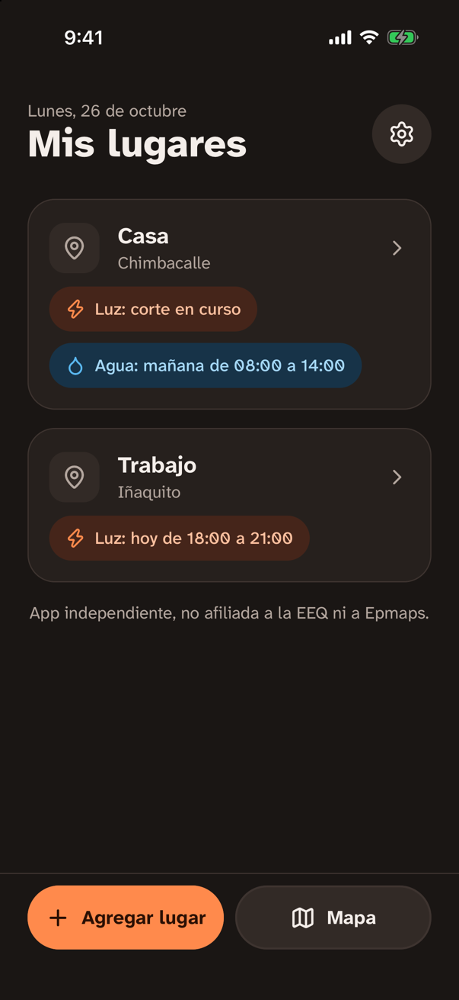
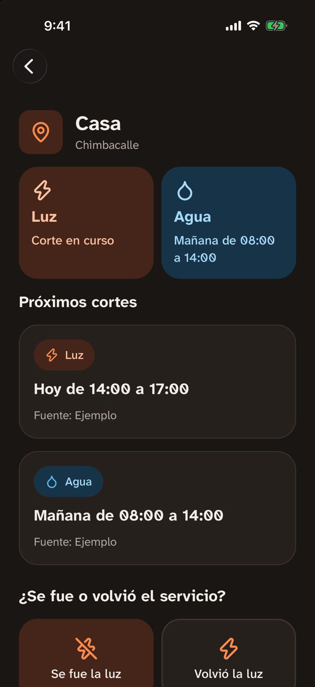
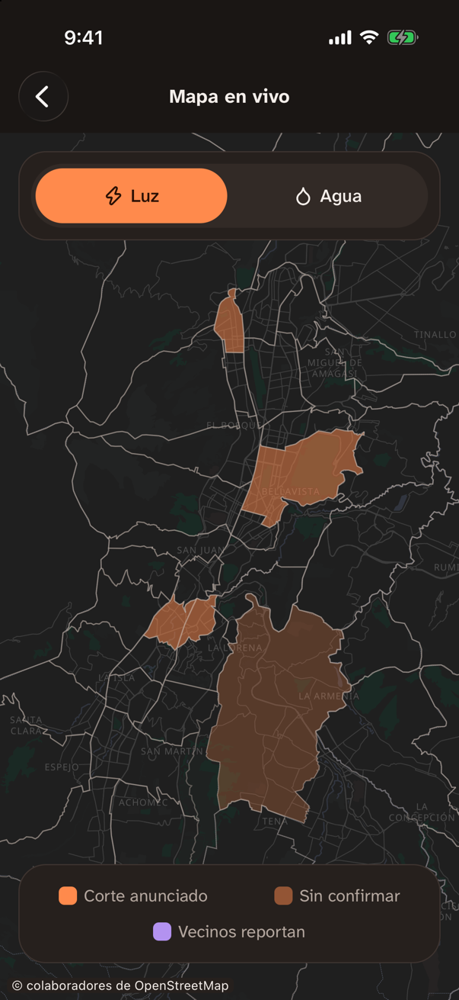

# Luz y Agua UIO

App gratuita y de código abierto que avisa a los quiteños de cortes de luz y agua en su barrio: los programados, a partir de fuentes oficiales públicas, y los no programados, a partir de reportes anónimos de vecinos.

> App independiente, no afiliada a la EEQ, a Epmaps ni al Municipio de Quito.

<p align="center">
  
  
  
</p>

## Estado

En desarrollo. La app todavía no está en Google Play ni en la App Store; la web y la app se pueden correr en local siguiendo [`CONTRIBUTING.md`](CONTRIBUTING.md). Los datos de las capturas son de ejemplo.

## Privacidad por diseño

- Sin cuentas: no pedimos nombre, cédula, teléfono, correo ni número de suministro.
- Tu ubicación nunca sale del teléfono: el barrio se calcula localmente.
- Los avisos llegan por temas de barrio; no sabemos quién recibe cada aviso.
- Sin analítica, publicidad ni rastreadores.

Estas garantías son reglas del código: están en [`docs/PRINCIPIOS.md`](docs/PRINCIPIOS.md). El diseño técnico completo está en [`docs/SPEC.md`](docs/SPEC.md).

## Estructura

| Carpeta              | Contenido                                           | Licencia |
| -------------------- | --------------------------------------------------- | -------- |
| `apps/mobile`        | App móvil (Expo)                                    | MIT      |
| `apps/web`           | Web pública (Next.js)                               | AGPL-3.0 |
| `packages/shared`    | Tipos, umbrales y temas de notificación compartidos | MIT      |
| `packages/extractor` | Lectura de cronogramas oficiales                    | AGPL-3.0 |
| `supabase`           | Base de datos, migraciones y funciones              | AGPL-3.0 |

El resto del repositorio está bajo AGPL-3.0. El nombre y el logo "Luz y Agua UIO" no están cubiertos por ninguna licencia de código.

## Datos

- Calles, mapa base y límites de las parroquias: © colaboradores de [OpenStreetMap](https://www.openstreetmap.org/copyright), bajo la licencia ODbL. Las teselas se sirven desde nuestro propio almacenamiento.
- Cortes programados: documentos públicos de la EEQ y de Epmaps. Nunca se extraen datos de sitios que lo prohíban (ver [`docs/SPEC.md`](docs/SPEC.md)).
- Cortes no programados: reportes anónimos de vecinos.

## Desarrollo

Requisitos y pasos en [`CONTRIBUTING.md`](CONTRIBUTING.md).

```bash
pnpm install
pnpm test
pnpm --filter mobile start
pnpm --filter web dev
supabase start
```

## Seguridad

Para reportar una vulnerabilidad, lee [`SECURITY.md`](SECURITY.md). No abras issues públicos para eso.
